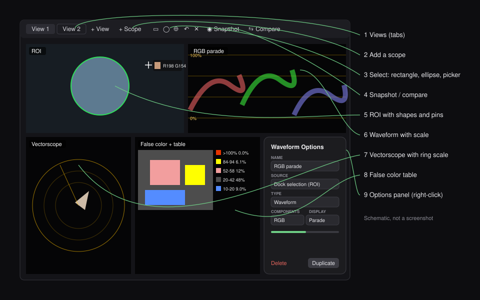

# Video Analyser for OBS Studio

Broadcast-style scopes inside OBS Studio: build your own scope dock with waveforms, vectorscopes,
histograms, a CIE diagram, a diamond display, false color, QC with a timeline, audio loudness and face
analysis across cameras. Arrange the scopes freely, look at just one part of the picture or follow faces,
measure SDR, HLG and PQ, apply LUTs and compare against a snapshot.

Video Analyser is based on [Color Monitor](https://github.com/norihiro/obs-color-monitor) by Norihiro Kamae
(GPL-2.0). It uses its own source ids, so both plugins can be installed side by side.

## Quick start

1. **Install.** Download the package for your system and OBS version from the
   [latest release](https://github.com/nielsnot/obs-video-analyser/releases/latest)
   (Windows installer, macOS `.pkg` or Linux `.deb`; for OBS 33 take the obs32 files) and restart OBS.
2. **Open a dock.** In OBS choose `Tools` → `New Video Analyser Dock...`, pick Program or Preview and click OK.
   The dock starts with an RGB parade, a luma waveform, a vectorscope and a histogram.
3. **Make it yours.** Click `+ Scope` to add scopes, right-click a scope to change it,
   and double-click a scope to fill the dock with it. Hover a scope for quick controls, and use `⊞ Arrange`
   to place and size the scopes wherever you like.
4. **Look at one part of the picture.** Click `◯ Ellipse` (or `▭ Rectangle`) and drag on the ROI view,
   for example around a face. Every scope now measures only what is inside.

## What you see in the dock

| # | Element | What it does |
|---|---------|--------------|
| 1 | **View tabs** and `+ View` | Several layouts per dock, each with its own scopes. Right-click a tab to rename, duplicate or delete it. |
| 2 | `+ Scope` | Adds a scope (see the list below). |
| 3 | `▭` `◯` `⊕` `↶` `✕` | Selection tools: draw rectangles and ellipses (`Shift` for squares and circles), place color picker pins, undo the last one, reset all. |
| 4 | `◉ Snapshot` / `⇆ Compare` | Freeze the picture and every scope as a reference, then show it: pink traces over the live scopes and reference \| live in the ROI view. |
| | `☺ Faces` | The selection follows every face found, so all scopes measure the faces. |
| | `⊞ Arrange` | Drag scopes anywhere in the dock and resize them at their bottom right corner (free layout, saved per view). |
| 5 | **ROI view** | The picture being analyzed. Shapes are outlined in green, faces in cyan, everything outside them is darkened. Pins show RGB, luma and HSL values. The mouse wheel zooms toward face height (or the pointer, or the middle). |
| 6 – 8 | **Scopes** | In a grid that fits the dock, in a row or column, or placed freely. Each shows a name label, optionally a colored frame to group the scopes of one camera. Hover one for quick controls: intensity, grid, color, gain, shape and full size. |
| 9 | **Options panel** | Right-click a scope: name, source, type, shape (auto, fill, 16:9, 4:3, 1:1), tile color, graticule and all its options, markers, order, maximize, projector, delete and duplicate. |

## The scopes

| Scope | Shows | Highlights |
|-------|-------|------------|
| **Waveform** | Levels across the picture | RGB, Luma, Chroma, YUV or YRGB; overlay, stack or parade; scale in %, IRE, 8-bit, 10-bit or nits; colorize; levels at the limits in orange; histogram along the right edge; pixel positions along the top; gain and mouse wheel zoom (for example into the blacks); markers |
| **Vectorscope** | Hue and saturation | Skin tone line, ring scale with degree ticks, colored hue ring, part of the picture (all, lows, mids or highs), gain and mouse wheel zoom, Rec. 601/709/2020 targets, markers as points or lines |
| **Histogram** | Distribution of levels | RGB, Luma, Chroma, YUV, plus Hue and Saturation; drag across a hue or saturation histogram to select that range |
| **CIE diagram** | Chromaticity | Spectral locus, Rec. 709, DCI-P3 and Rec. 2020 triangles, D65 white point |
| **Diamond** | RGB gamut | Anything outside the dashed outlines is out of gamut |
| **False color** | Exposure as colors | Presets (Exposure, Clipping only, Skin and mid grey, Spectrum) or your own bands; optional table with the share of the picture in each band |
| **Zebra** | Over- and underexposure | Adjustable thresholds |
| **Focus peaking** | Sharp edges | Color and threshold |
| **QC and MinMax** | Signal checks | Min/max of R, G, B and luma, APL, clipped and crushed share, black borders, black and frozen picture, MaxCLL/MaxFALL and out-of-Rec. 709 share for HDR; a timeline of 1 min to 4 h with failed stretches in red; a timestamped error log, also as CSV; optional EBU R103 low-pass |
| **Sat / Lum** | Saturation against luma | Shows whether highlights or shadows carry too much color |
| **Line plot** | One picture line | R, G, B and luma of the line you choose |
| **3D color cube** | Every pixel in the RGB cube | Turns by itself; drag to turn, wheel to zoom |
| **Audio meter** | Sound | Peak per channel with hold, EBU R128 loudness (momentary, short-term with maximum, integrated) against a target, a loudness timeline of 30 s to 1.5 h, phase correlation, goniometer for stereo and a room meter for 5.1 and 7.1 |
| **Faces** | Faces in up to four cameras | Finds and follows faces; per camera a thumbnail with the faces, scene levels (median, P10-P90, P99, near black, near clipping), face luma, hue against the skin tone line and saturation, written advice and the difference to camera 1 |
| **Info and timecode** | Time and format | Time-of-day timecode, clock, date, video format and your own text |

## Tools

- **Selections.** Draw any number of rectangles and ellipses on the ROI view. The scopes count only the pixels inside
  them. This selects what is measured; it does not zoom the picture.
- **Qualifier.** In the ROI options, limit the analysis to a hue, saturation and luma range, such as skin tones.
  The quickest way is to drag across a Hue or Saturation histogram.
- **Color picker.** With `⊕ Picker` on, each click places a pin (up to 8) that reads the color under it.
- **Own source per scope.** In a scope's options, set `Source` to a camera or scene instead of the dock selection,
  so one dock can show scopes for several cameras.
- **Snapshot and compare.** Take a reference with `◉ Snapshot`, then match a second camera or a new grade against it.
- **Markers.** In the options of a waveform or vectorscope, add markers: lines at a level, or points and lines at a
  hue and saturation on the vectorscope (also straight from a color picker pin). Each has a name, color and style.
- **3D LUT.** In the ROI options, load a `.cube` LUT and apply it to the ROI view only or to everything the scopes
  measure, for example to check a log camera through its conversion LUT or an HLG to SDR conversion.
- **Waveform colorize.** A luma waveform can draw its trace in the colors of the picture.
- **Follow faces.** `☺ Faces` turns the selection into the faces found, and it moves with them.
- **Free layout.** `⊞ Arrange` lets you drag and resize every scope; give scopes of one camera the same tile color.
- **Quick controls.** Hover a scope for intensity, grid, color, gain, shape and full size without opening the options.

More details: [Dock](doc/dock.md), [Waveform](doc/waveform.md), [Vectorscope](doc/vectorscope.md),
[Histogram](doc/histogram.md), [False Color](doc/falsecolor.md), [Zebra](doc/zebra.md),
[Focus Peaking](doc/focuspeaking.md), [Global Configuration](doc/global_config.md).

## HDR (HLG and PQ)

Video Analyser measures Rec. 2100 HLG and PQ. Set your OBS project to HDR (`Settings` → `Advanced` → `Video`:
color format P010 or I010, color space Rec. 2100 (HLG) or (PQ)) and the dock follows automatically; or right-click
the ROI view and set `Color space` yourself.

- The picture is captured in linear float and encoded to the HLG or PQ signal exactly as OBS encodes its HDR
  output, with Rec. 2020 primaries and matrix. OBS's `SDR white level` decides where SDR material lands
  (203 nits = 75 % in HLG, 58 % in PQ).
- **Waveform:** a dashed line marks reference white; `Scale values` → `Nits` labels the lines in nits.
- **QC:** MaxCLL and MaxFALL, and the share of colors outside Rec. 709.
- **Vectorscope:** Rec. 2020 targets, skin tone line and hue ring.
- **False color:** the `HDR HLG levels` preset (18 % grey near 38 %, skin, reference white at 75 %).
- **CIE diagram:** plots in Rec. 2020; compare with the Rec. 709 triangle to see wide-gamut colors.
- The ROI view shows the picture as SDR with highlights above SDR white clipped.

The scopes measure the HDR signal in 8 bits.

## Scopes as sources

Every scope is also an OBS source. Add one to a scene with `+` in the Sources list, choose the camera or scene
to analyze, and open a windowed projector to watch it on another screen. If it costs too much rendering time,
raise `Scale` to analyze a smaller image; `Bypass` shows that image to check you picked the right source.

## Building

GitHub Actions builds the plugin for Windows, macOS and Linux for OBS 30, 31 and 32 (the OBS 32 build also runs on
OBS 33) on every push to `main`, tests it in OBS, and publishes a release when the version in `CMakeLists.txt` is new.
What changed in each version is in the [changelog](CHANGELOG.md). Locally the plugin builds with CMake against
OBS Studio and Qt 6.

## License

GPL-2.0-or-later, see [LICENSE](LICENSE). Based on Color Monitor by Norihiro Kamae.
Face detection uses [libfacedetection](https://github.com/ShiqiYu/libfacedetection) by Shiqi Yu
(BSD 3-clause, see [deps/libfacedetection/LICENSE](deps/libfacedetection/LICENSE)).
